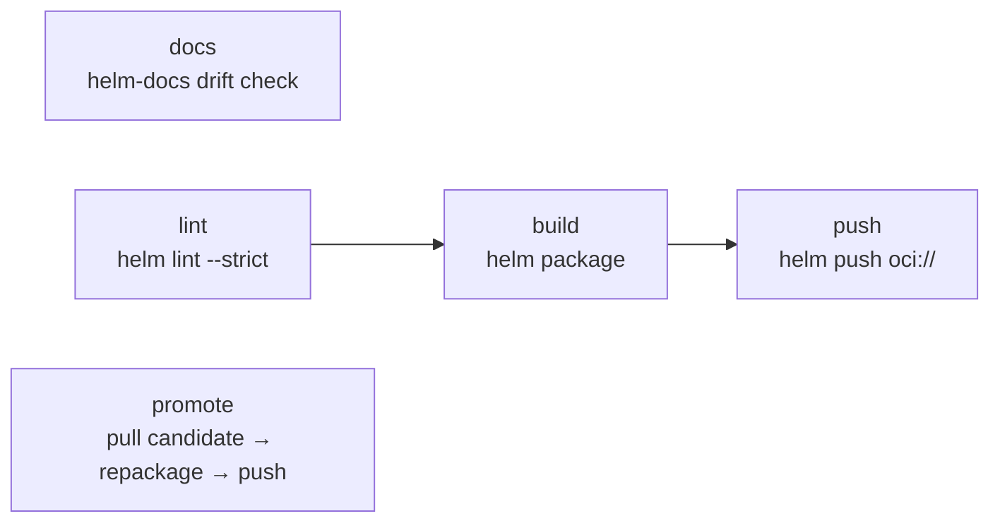

# chart

Helm chart packaging and publishing over **OCI**, the registry protocol both platforms
share. GitHub requires `CHART_REGISTRY` for publishing; there is no package-registry fallback.
See [registry configuration](../configuration.md#helm-chart-publishing--authentication), and
[publishing to several registries](../configuration.md#publishing-to-several-registries) when
`PROJECT_REGISTRY_NAME` names a credential group.

| Workflow · Job | Description |
| --- | --- |
| `chart.yml` · `docs` | Regenerates `chart/README.md` with `helm-docs` and fails on drift, showing the diff and the exact command in the summary. |
| `chart.yml` · `lint` | `helm lint --strict`, with optional inline value overrides. |
| `chart.yml` · `unittest` | **Optional, opt-in** (`run-unittest: true`, default `false`). `mock-chart` accepts one or more space-separated mock consumer chart directories (default `tests`); each gets a dependency update and runs `helm unittest --strict` against its own `tests/*_test.yaml` suite glob, preventing suites from being cross-run against other charts. Individual JUnit reports are uploaded together. For repositories that *ship* a chart others depend on; requires the `unittest` Helm plugin in the job image. |
| `chart.yml` · `build` | `helm package --version --app-version`. Uploads `chart-package`. |
| `chart.yml` · `push` | `helm push` to every chart repository when `publish-candidate: true` (default). Set it to `false` for PR verification when the candidate OCI repository is not provisioned; release promotion remains separate. Writes `CHART_INFO.md` when it runs. On Docker Hub, candidate and release versions use the same namespace-root repository. |
| `chart.yml` · `promote` | Release-mode only. Pulls the exact candidate from the primary repository, repackages at the release tag, and pushes to production, then pushes the same package to every other repository. On Docker Hub, the source and destination repository are intentionally the same. |
| `scan.yml` (`scan-type: config`, `config-type: chart`) | Renders templates, then runs a Trivy misconfiguration scan. |
| `check.yml` · `chart-existence` / `chart-dependency` | Version collision (in every repository) and development-dependency guards. |

## Chart-only repositories

A repository whose only artifact is a chart has no dependency, build or test jobs; its path is
`helm dependency update` → `helm lint --strict` → `helm template`. Set `CHART_DIR` to `.` when
`Chart.yaml` is at the repository root, as library and umbrella charts usually are. A
`type: library` chart has no `values.schema.json`, no `manifest.yaml` and no `tpl-library`
dependency of its own, so the application-chart standards do not apply to it.

[Documentation index](../../README.md)
